

  <a href="https://waqaszafar.tech"></a>

  <a href="https://waqaszafar.tech"></a>
  
  <a href="mailto:mwaqaszafar76@gmail.com"></a>

  

<!-- repos:start -->

  <a href="https://github.com/WaqasZafar9/WEB-DEV-PROJECTS"></a> <a href="https://github.com/WaqasZafar9/CPP-PROJECTS"></a>

  <a href="https://github.com/WaqasZafar9/Galaxy-Cricket-Website"></a> <a href="https://github.com/WaqasZafar9/VPN-For-Remote-Access"></a>

  <a href="https://github.com/WaqasZafar9/Smart-E-License-System"></a> <a href="https://github.com/WaqasZafar9/socialswirl"></a>

<!-- repos:end -->

  

Cards are rendered daily by <code>scripts/render_cards.py</code> from <code>data/contributions.json</code>.
